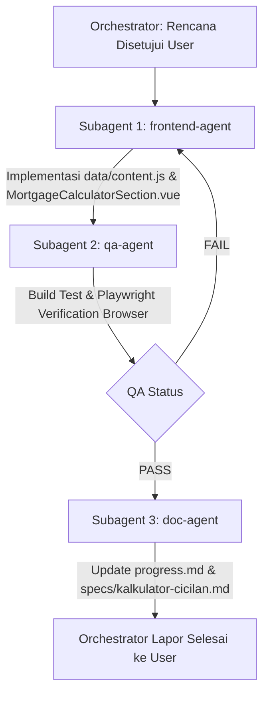

# Rencana Implementasi: Section Kalkulator Cicilan KPR (Simulasi Anuitas)

Dokumen desain teknis dan rencana eksekusi untuk penambahan section baru **Kalkulator Cicilan KPR** di landing page Sanggar Indah Palastri.

---

## 1. Goal Description

Menambahkan section interaktif baru berupa **Kalkulator Cicilan KPR** yang memungkinkan calon pembeli menghitung simulasi pembiayaan rumah secara mandiri dan akurat, sesuai dengan formula bunga anuitas pada file Excel proyek.

### Fitur Utama:
1. **Harga Rumah (Bisa diisi manual):** Input nilai harga rumah dengan format Rupiah otomatis (`Rp xxx.xxx.xxx`) dan tombol reset `(x)`. Disediakan opsi tombol *quick-preset* tipe rumah (Tipe 22/60 & Tipe 31/72).
2. **Uang Muka (Sinkronisasi Dua Arah):**
   - Mengisi persentase ($\%$) $\rightarrow$ nominal uang muka otomatis terisi.
   - Mengisi nominal uang muka ($\text{Rp}$) $\rightarrow$ persentase otomatis terisi dan disesuaikan.
   - Dilengkapi *slider* interaktif (5% s/d 90%) untuk kemudahan interaksi di mobile & desktop.
3. **Plafon Kredit Otomatis:** $\text{Plafon} = \text{Harga Rumah} - \text{Uang Muka}$.
4. **Tenor Kredit:** Dropdown pilihan 5, 10, 15, dan 20 tahun (60, 120, 180, 240 bulan).
5. **Perhitungan Bunga Anuitas Presisi (Sesuai Excel):**
   - Menggunakan suku bunga $5\%$ per tahun ($r = 0.05 / 12$ per bulan).
   - Menghitung angsuran per bulan secara reaktif tanpa perlu refresh.
   - Menampilkan rincian estimasi biaya akad/biaya proses (Provisi $0.5\%$, Administrasi Rp 500.000, dan total biaya awal).
6. **Desain Visual & Aset:**
   - Mengikuti *Design System* Sanggar Indah Palastri (*Natural Scandinavian × Modern Editorial*, palet `--paper`, `--green`, `--sage-pale`, font `Dream Orphans` & `Poppins`).
   - Menggunakan aset foto hunian dari proyek (`/assets/images/palastri/rumah/3172-3d.webp` atau `2260-3d.webp`).
7. **Action CTA:** Tombol konsultasi WhatsApp yang otomatis merangkum hasil simulasi pengguna (Harga, DP, Plafon, Tenor, Estimasi Angsuran) ke nomor tim marketing.

---

## 2. Analisis Formula Matematika (Verifikasi vs Excel)

Berdasarkan data Excel yang diberikan:
$$\text{Formula Anuitas Bulanan: } A = P \times \frac{r \times (1 + r)^n}{(1 + r)^n - 1}$$

Di mana:
- $P$ = Plafon Pengajuan ($\text{Harga Jual} - \text{Uang Muka}$)
- $i$ = Suku bunga per tahun = $0.05$ ($5\%$)
- $r$ = Suku bunga per bulan = $i / 12 = 0.05 / 12 \approx 0.0041666667$
- $n$ = Jumlah angsuran (bulan) = $\text{Tenor (Tahun)} \times 12$

### Uji Akurasi Nilai Excel ($P = \text{Rp } 243.650.000$):
| Tenor ($n$) | Hasil Rumus (JS) | Nilai di Excel User | Selisih |
|---|---|---|---|
| **5 Tahun (60 bln)** | Rp 4.597.976,08 | Rp 4.597.976,08 | Rp 0,00 (Identik) |
| **10 Tahun (120 bln)** | Rp 2.584.286,28 | Rp 2.584.286,28 | Rp 0,00 (Identik) |
| **15 Tahun (180 bln)** | Rp 1.926.768,67 | Rp 1.926.768,67 | Rp 0,00 (Identik) |
| **20 Tahun (240 bln)** | Rp 1.607.982,16 | Rp 1.607.982,16 | Rp 0,00 (Identik) |

### Biaya Proses Tambahan (Sesuai Excel):
- **Provisi:** $0.5\% \times \text{Plafon}$ (Contoh untuk $P = 243.650.000 \rightarrow \text{Rp } 1.218.250$)
- **Administrasi Bank:** $\text{Rp } 500.000$ (Flat)
- **Total Estimasi Biaya Proses:** $\text{Angsuran Pertama} + \text{Provisi} + \text{Administrasi}$

---

## 3. UI/UX Layout & Alur Interaksi

```
┌────────────────────────────────────────────────────────────────────────┐
│                   [Eyebrow: SIMULASI ANGSURAN]                         │
│               Hitung Simulasi Cicilan Rumah Anda                       │
│    Rencanakan pembelian rumah impian Anda dengan kalkulator berikut.   │
├─────────────────────────────────────────────────────────┬──────────────┤
│  KOLOM KIRI: INPUT FORM                                 │  KOLOM KANAN │
│                                                         │  [FOTO RUMAH │
│  🏠 Harga Rumah                                         │   PALASTRI]  │
│  ┌──────────────────────────────────────────────┬────┐  │              │
│  │ Rp 297.740.000                               │ ✕  │  │              │
│  └──────────────────────────────────────────────┴────┘  │              │
│  Quick Preset: [ Tipe 22/60 ] [ Tipe 31/72 ]            │              │
│                                                         │              │
│  👛 Uang Muka (DP)                                      │              │
│  ┌──────────────────────────────┬────────────────────┐  │              │
│  │ Rp 54.090.000                │  [ 20% ▼ ]         │  │              │
│  └──────────────────────────────┴────────────────────┘  │              │
│  [========●=======================================]     │              │
│  5%                                             90%     │              │
│                                                         │              │
│  📅 Tenor Pinjaman                                      │              │
│  ┌───────────────────────────────────────────────────┐  │              │
│  │ 15 Tahun (180 Bulan)                            ▼ │  │              │
│  └───────────────────────────────────────────────────┘  │              │
│                                                         │              │
│  ┌─ KARTU HASIL ESTIMASI ────────────────────────────┐  │              │
│  │ Plafon (Jumlah Kredit):   Rp 243.650.000          │  │              │
│  │ ───────────────────────────────────────────────── │  │              │
│  │ 🗓 Cicilan per Bulan:                             │  │              │
│  │   Rp 1.926.769 /bulan                             │  │              │
│  │                                                   │  │              │
│  │ ▾ Rincian Biaya Akad Awal (Provisi & Admin Bank)  │  │              │
│  │   • Provisi (0.5%): Rp 1.218.250                  │  │              │
│  │   • Administrasi: Rp 500.000                      │  │              │
│  │   • Total Biaya Pertama: Rp 3.645.019             │  │              │
│  │                                                   │  │              │
│  │ [ 📲 Konsultasi Simulasi via WhatsApp ➔ ]        │  │              │
│  └───────────────────────────────────────────────────┘  │              │
└─────────────────────────────────────────────────────────┴──────────────┘
```

---

## 4. Proposed Changes

### A. Data Layer (`data/content.js` & `composables/useContent.js`)
#### [MODIFY] [data/content.js](file:///c:/Users/Salivs/Data/laragon/www/landingpage-sip/data/content.js)
- Menambahkan konfigurasi `calculator` ke dalam objek content:
  - Copywriting section: `eyebrow`, `title`, `titleLines`, `subtitle`, `footnote`
  - Konfigurasi finansial: `defaultPrice: 297740000`, `defaultDpPercent: 20`, `defaultTenor: 15`, `annualInterestRate: 0.05`, `provisionRate: 0.005`, `adminFee: 500000`
  - Array tenor: `[5, 10, 15, 20]`
  - Preset harga rumah berdasarkan `houseTypes` (Tipe 22/60 & Tipe 31/72)
  - Template pesan WhatsApp:
    `"Halo tim marketing Palastri, saya ingin konsultasi simulasi KPR:\n- Harga Rumah: {harga}\n- Uang Muka: {dp} ({dpPercent}%)\n- Plafon KPR: {plafon}\n- Tenor: {tenor} Tahun\n- Estimasi Cicilan: {cicilan}/bln\nBoleh bantu info ketersediaan unit & persyaratannya?"`

#### [MODIFY] [composables/useContent.js](file:///c:/Users/Salivs/Data/laragon/www/landingpage-sip/composables/useContent.js)
- Memastikan `content.calculator` diekspos dengan path gambar dinormalisasi via `withBase()`.
- Menambahkan helper `calculateKpr(price, dpNominal, tenorYears, interestRate)` atau mengekspos formula di composable/komponen.

---

### B. Komponen UI
#### [NEW] [components/MortgageCalculatorSection.vue](file:///c:/Users/Salivs/Data/laragon/www/landingpage-sip/components/MortgageCalculatorSection.vue)
- Komponen Vue 3 (`<script setup>`) dengan fitur:
  - State reaktif:
    - `price` (number)
    - `dpNominal` (number)
    - `dpPercent` (number)
    - `tenorYears` (number, default: 15)
    - `showBreakdown` (boolean)
  - Sinkronisasi dua arah (*Two-Way Binding*):
    - Ubah `dpPercent` $\rightarrow$ `dpNominal = Math.round(price * (dpPercent / 100))`
    - Ubah `dpNominal` $\rightarrow$ `dpPercent = Number(((dpNominal / price) * 100).toFixed(1))`
    - Ubah `price` $\rightarrow$ update `dpNominal` sesuai `dpPercent` yang sedang aktif
  - Formatter Rupiah interaktif dengan pemisah ribuan titik (`Rp 297.740.000`).
  - Dropdown tenor custom / native select berdesain Palastri.
  - Kartu kalkulasi reaktif yang langsung terupdate tanpa tombol hitung manual.
  - Generator URL WhatsApp instan dengan teks dinamis.
  - Tampilan responsif mobile-first (375px hingga 1280px+).

---

### C. Integrasi Halaman Utama
#### [MODIFY] [pages/index.vue](file:///c:/Users/Salivs/Data/laragon/www/landingpage-sip/pages/index.vue)
- Menyisipkan `<MortgageCalculatorSection />` tepat setelah `<ProductsSection />` dan sebelum `<WhySection />`.
- Menambahkan id `#kalkulator` sehingga dapat ditautkan langsung dari navigasi atau tombol "Simulasi Cicilan" pada modal tipe rumah.

#### [MODIFY] [data/content.js](file:///c:/Users/Salivs/Data/laragon/www/landingpage-sip/data/content.js) *(Navigasi)*
- Menambahkan menu `Simulasi KPR` ke dalam `meta.nav` agar calon pembeli dapat langsung melompat ke section kalkulator dari header.

---

### D. Dokumentasi & Spesifikasi
#### [NEW] [docs/superpowers/specs/kalkulator-cicilan.md](file:///c:/Users/Salivs/Data/laragon/www/landingpage-sip/docs/superpowers/specs/kalkulator-cicilan.md)
- Spesifikasi lengkap fitur kalkulator cicilan: formula, aturan validasi, acceptance criteria Given/When/Then, dan mapping data.
#### [MODIFY] [docs/progress.md](file:///c:/Users/Salivs/Data/laragon/www/landingpage-sip/docs/progress.md)
- Menambahkan checklist pengerjaan section kalkulator cicilan.

---

## 5. Subagent Execution Pipeline

Sesuai aturan Orchestrator, Main Agent mendelegasikan tugas ke subagent spesialis:



1. **`frontend-agent`**:
   - Memperbarui `data/content.js` & `composables/useContent.js`
   - Membuat `components/MortgageCalculatorSection.vue`
   - Mengintegrasikan section di `pages/index.vue`
   - Melakukan uji build awal (`npm run build`)
2. **`qa-agent`**:
   - Menjalankan build test (`npm run build` / `nuxi generate`)
   - Membuka halaman di browser melalui Playwright MCP
   - Menguji interaktivitas:
     - Input harga manual
     - Perubahan persentase DP $\rightarrow$ nominal DP terupdate
     - Perubahan nominal DP $\rightarrow$ persentase DP terupdate
     - Slider DP
     - Perubahan dropdown tenor (5, 10, 15, 20 tahun)
     - Validasi nilai cicilan bulanan terhadap nilai Excel
     - Verifikasi link WhatsApp
     - Pengujian mobile viewport (375px & 390px)
3. **`doc-agent`**:
   - Menyusun dokumen `docs/superpowers/specs/kalkulator-cicilan.md`
   - Memperbarui checklist di `docs/progress.md`

---

## 6. Verification Plan

### Automated / Build Checks
```powershell
npm run build
```
- Memastikan tidak ada compile error, TypeScript error, atau masalah SSR/SSG.

### Verifikasi Interaktif (Playwright MCP)
1. **Verifikasi Angka Excel:**
   - Input: Harga Rp 297.740.000, DP 20% (Plafon Rp 238.192.000 atau Rp 243.650.000).
   - Pastikan nominal cicilan per bulan di UI sama persis hingga satuan Rupiah dengan rumus anuitas Excel.
2. **Verifikasi Sinkronisasi DP:**
   - Ubah persentase ke 25% $\rightarrow$ pastikan nominal DP menjadi Rp 74.435.000.
   - Ubah nominal DP ke Rp 50.000.000 $\rightarrow$ pastikan persentase terupdate menjadi 16.8%.
3. **Verifikasi Tenor:**
   - Pilih 5, 10, 15, dan 20 tahun $\rightarrow$ angka cicilan terupdate seketika.
4. **Verifikasi Responsivitas Mobile:**
   - Cek layout pada viewport 375x667 (iPhone SE) dan 390x844 (iPhone 12/13).
   - Pastikan form input, slider, kartu hasil, dan gambar tertata rapi tanpa horizontal overflow.
