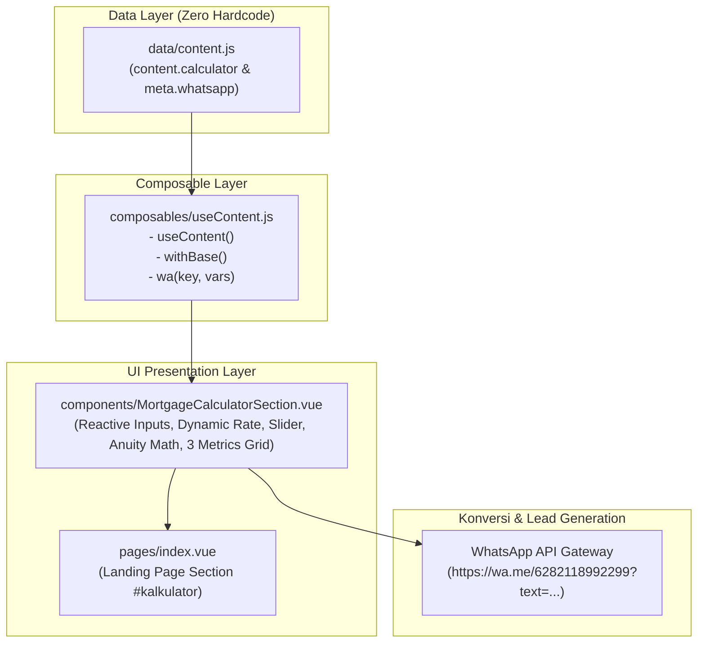

# Spesifikasi Fitur: Kalkulator Cicilan KPR (Simulasi Bunga Anuitas Dinamis)

- **Dokumen ID**: `SPEC-FEAT-MORTGAGE-CALC-002`
- **Tanggal Dokumen**: 2026-11-11
- **Pembaruan Terakhir**: 2026-11-12 (Versi 2.1 - Suku Bunga Dinamis, Layout Responsif 2 Kolom Bunga & Tenor, Lean UI & Penyesuaian Spacing)
- **Status Fitur**: Selesai (`QA PASS 100%`)
- **Komponen Terkait**:
  - [`components/MortgageCalculatorSection.vue`](file:///c:/Users/Salivs/Data/laragon/www/sipar/components/MortgageCalculatorSection.vue)
  - [`components/ProductsSection.vue`](file:///c:/Users/Salivs/Data/laragon/www/sipar/components/ProductsSection.vue) (Harmonisasi Spacing & Heading)
- **Data Layer**: [`data/content.js`](file:///c:/Users/Salivs/Data/laragon/www/sipar/data/content.js) (`content.calculator`), [`composables/useContent.js`](file:///c:/Users/Salivs/Data/laragon/www/sipar/composables/useContent.js)
- **Halaman Integrasi**: [`pages/index.vue`](file:///c:/Users/Salivs/Data/laragon/www/sipar/pages/index.vue) (Anchor `#kalkulator`)
- **Skema Suku Bunga**: Suku Bunga Dinamis/Manual (% per tahun, default 5.0% p.a.) dengan Formula Anuitas Bulanan
- **Viewport Terverifikasi**: Desktop 1440×900, Desktop 1280×720, Mobile 375×667, Mobile 390×844

---

## Ringkasan Riwayat Revisi (Update 2026-11-12)

Pada tanggal 12 November 2026, fitur kalkulator cicilan KPR dan section produk di atasnya diperbarui dengan penyempurnaan desain antarmuka, penyederhanaan alur, dan fleksibilitas perhitungan:

1. **Input Suku Bunga Dinamis / Manual (% per tahun)**:
   - Menambahkan field input numerik suku bunga tahunan reaktif (`min="0"`, `max="30"`, `step="0.1"`).
   - Nilai suku bunga langsung terhubung secara real-time ke formula perhitungan bunga anuitas bulanan.
2. **Grid 3 Metrik Reaktif Real-Time**:
   - Tiga kartu ringkasan metrik (Bunga KPR, Uang Muka, Tenor KPR) diperbarui secara instan mengikuti perubahan input suku bunga dinamis, persentase DP, dan pilihan tenor pinjaman.
3. **Eliminasi Preset Tipe Rumah & Accordion Biaya Akad Awal (Clean Code & Lean UX)**:
   - Menghapus deretan tombol preset tipe rumah agar pengguna memiliki keleluasaan memasukkan harga unit tanpa redundansi visual.
   - Menghapus komponen akordeon rincian biaya awal akad kredit (biaya provisi & administrasi) untuk menyederhanakan antarmuka, menghindari over-kompleksitas, dan memfokuskan calon konsumen pada besaran cicilan bulanan utama.
4. **Penyederhanaan Disclaimer Netral Tanpa Logo Bank**:
   - Menghilangkan badge logo bank spesifik (BCA) pada pill disclaimer.
   - Mengubah narasi catatan kaki menjadi disclaimer netral dan edukatif bahwa simulasi bersifat patokan estimasi dan suku bunga riil mengikuti kebijakan bank penyalur KPR.
5. **Perampingan Whitespace Antar-Section & Harmonisasi Heading**:
   - Merampingkan padding vertikal `ProductsSection.vue` (`pt-12 pb-6 md:pt-16 md:pb-8`) dan `MortgageCalculatorSection.vue` (`pt-6 pb-16 lg:pt-8 lg:pb-20`).
   - Kedua section menyelaraskan judul dengan format rata tengah (*center-aligned*) dan meniadakan eyebrow untuk estetika visual yang konsisten dan elegan.
6. **Layout Responsif 2 Kolom Suku Bunga & Tenor (Efisiensi Ruang Vertikal)**:
   - Form input suku bunga tahunan dan seleksi tenor pinjaman kini disajikan berdampingan dalam sub-grid 2 kolom (`grid-cols-1 sm:grid-cols-2 gap-4`) pada layar tablet dan desktop ($\ge 640\text{px}$) guna memaksimalkan efisiensi ruang vertikal pada kartu formulir.
   - Pada layar smartphone mobile ($< 640\text{px}$), susunan kembali bertumpuk rapi secara vertikal 1 kolom agar area input tetap leluasa dan mudah dioperasikan.
   - Label judul input diproteksi dengan utilitas Tailwind `truncate` dan badge indikator status diproteksi dengan `shrink-0 whitespace-nowrap` (`% p.a.` dan `Thn`) guna mencegah teks terlipat (*text wrap*) atau mendesak elemen form saat viewport mengecil.

---

## 1. Latar Belakang & Tujuan Fitur

### 1.1 Permasalahan Bisnis & Pengguna
1. **Kebutuhan Fleksibilitas Finansial**: Calon pembeli rumah memiliki skema pembiayaan perbankan yang bervariasi (KPR subsidi FLPP bunga tetap 5%, KPR komersil fixed promo 3%-7%, atau KPR reguler perbankan). Suku bunga tetap yang terkunci pada satu angka membatasi relevansi simulasi bagi pengguna.
2. **Kerapian & Fokus Antarmuka (Clutter Reduction)**: Informasi biaya akad perbankan yang terlalu rinci (seperti provisi dan admin bank) pada tahap awal eksplorasi justru dapat menimbulkan keraguan konsumen (*information overload*). Konsumen membutuhkan estimasi cicilan bulanan yang cepat, to-the-point, dan mudah dipahami.
3. **Friksi Kontak Manual**: Pengguna enggan langsung menghubungi tim sales bila belum memiliki estimasi angka yang jelas, atau sebaliknya, tim sales menghabiskan banyak waktu mengulang simulasi dasar secara manual melalui chat WhatsApp.

### 1.2 Tujuan & Nilai Tambah Fitur
1. **Transparansi Finansial Interaktif**: Pengunjung dapat mensimulasikan cicilan KPR dengan memasukkan harga rumah, DP, suku bunga, dan tenor secara mandiri langsung di landing page tanpa reload halaman.
2. **Kesesuaian Standar Perbankan Nasional**: Menggunakan formula aktuaria bunga anuitas bulanan standar perbankan nasional ($A = P \times \frac{r(1+r)^n}{(1+r)^n - 1}$) dengan suku bunga dinamis yang akurat.
3. **Sinkronisasi Dua Arah Uang Muka (DP)**: Sinkronisasi instan antara input nominal Rupiah, persentase (%), dan range slider (5% s/d 90%) dengan track visual proporsional.
4. **High-Conversion WhatsApp Marketing Lead**: Mengonversi hasil simulasi pengguna langsung ke obrolan WhatsApp marketing resmi SIPAR dengan parameter simulasi yang terisi secara otomatis (*pre-filled message*).

---

## 2. Arsitektur Komponen & Data Layer (Zero Hardcode)

Komponen dirancang dengan prinsip **Zero Hardcode**. Seluruh teks, label antarmuka, parameter default finansial, daftar tenor, aset gambar, hingga template pesan WhatsApp didefinisikan secara terpusat di `data/content.js` dan diakses melalui composable `useContent()`.

### 2.1 Diagram Alur Data & Komponen



### 2.2 Struktur Konfigurasi Data (`content.calculator`)

Konfigurasi pada [`data/content.js`](file:///c:/Users/Salivs/Data/laragon/www/sipar/data/content.js):

```javascript
calculator: {
  id: 'kalkulator',
  eyebrow: '',
  titleLines: ['Hitung Simulasi', 'Cicilan Rumah Anda'],
  subtitle: 'Rencanakan pembelian rumah impian Anda dengan mudah menggunakan kalkulator cicilan berikut.',
  defaultPrice: 166000000,              // Patokan harga awal unit (misal Tipe 22/60 Subsidi)
  defaultDpPercent: 5,                  // Minimal Uang Muka awal 5%
  defaultTenor: 20,                     // Default tenor 20 tahun (240 bulan)
  defaultInterestRatePercent: 5,        // Default suku bunga tahunan 5%
  annualInterestRate: 0.05,             // Suku bunga referensi 5.0% p.a.
  provisionRate: 0.005,
  adminFee: 500000,
  minDpPercent: 5,                      // Batas bawah slider 5%
  maxDpPercent: 90,                     // Batas atas slider 90%
  tenors: [
    { value: 5, label: '5 Tahun (60 Bulan)' },
    { value: 10, label: '10 Tahun (120 Bulan)' },
    { value: 15, label: '15 Tahun (180 Bulan)' },
    { value: 20, label: '20 Tahun (240 Bulan)' },
  ],
  metrics: [
    { label: 'Bunga KPR', value: '5.0% p.a.' },
    { label: 'Uang Muka', value: 'Mulai 5%' },
    { label: 'Tenor KPR', value: 's/d 20 Thn' },
  ],
  footnote: '*Perhitungan simulasi ini hanya sebagai patokan/estimasi. Perhitungan riil dan suku bunga di bank dapat berbeda sesuai kebijakan bank yang berlaku.',
  ctaLabel: 'Konsultasi Simulasi via WhatsApp',
  image: '/assets/images/rumah/galeri/3672-3d-ilustrasi.webp',
  imageAlt: 'Ilustrasi Hunian Modern Sanggar Indah Parahyangan',
  labels: {
    housePrice: 'Harga Rumah',
    interestRate: 'Suku Bunga (% per tahun)',
    downPayment: 'Uang Muka (DP)',
    downPaymentNominal: 'Uang Muka Nominal',
    downPaymentPercent: 'Persentase DP',
    tenor: 'Jangka Waktu Pinjaman',
    years: 'Tahun',
    months: 'Bulan',
    clearLabel: 'Hapus input harga',
    minDp: '5% Min DP',
    midDp: '50%',
    maxDp: '90% Max DP',
    plafonTitle: 'Plafon Pembiayaan KPR',
    installmentTitle: 'Estimasi Cicilan per Bulan',
    perMonth: '/bulan',
  },
}
```

### 2.3 Desain Layout UI (1 Card Landscape 2 Kolom)

Layout mengusung arsitektur visual satu wadah kartu besar (`rounded-[26px]`) dengan split 2 kolom seimbang pada layar desktop (`lg:grid-cols-12` dengan pembagian `lg:col-span-6` & `lg:col-span-6`), dilengkapi latar belakang gambar hunian 3D subtle dengan gradasi vertikal (*vertical fade*). Pada kolom formulir finansial (kiri), field Suku Bunga dan Tenor disusun berdampingan dalam sub-grid responsif 2 kolom (`grid-cols-1 sm:grid-cols-2 gap-4`) untuk efisiensi ruang vertikal:

```
┌────────────────────────────────────────────────────────────────────────────────────────┐
│ [Latar Belakang: Gambar Hunian 3D Modern - Opacity 10-15% + Vertical Fade Gradient]   │
│                                                                                        │
│                           Hitung Simulasi Cicilan Rumah Anda                           │
│              Rencanakan pembelian rumah impian Anda dengan mudah...                    │
│                                                                                        │
│  ┌─ SATU CARD LANDSCAPE 2 KOLOM (bg-white, rounded-[26px], border-cream-light, shadow)─┐  │
│  │                                                   │                              │  │
│  │  KOLOM 1 (KIRI, 6 Col): FORM INPUT FINANSIAL      │  KOLOM 2 (KANAN, 6 Col):     │  │
│  │                                                   │  RINGKASAN ESTIMASI & CTA    │  │
│  │  🏠 Harga Rumah             [Rp 166.000.000]      │  Plafon Pembiayaan KPR       │  │
│  │  ┌──────────────────────────────────────────┬───┐ │    Rp 157.700.000            │  │
│  │  │ Rp 166.000.000                           │ ✕ │ │  ──────────────────────────  │  │
│  │  └──────────────────────────────────────────┴───┘ │  ┌─ BOX ESTIMASI CICILAN ──┐ │  │
│  │                                                   │  │ Estimasi Cicilan/Bulan  │ │  │
│  │  👛 Uang Muka (DP) - 5% (Rp 8.300.000)            │  │ Rp 1.040.750 /bulan     │ │  │
│  │  ┌────────────────────────┬─────────────────────┐ │  └─────────────────────────┘ │  │
│  │  │ Rp 8.300.000           │  5 %                │ │  ┌─ 3 METRICS GRID ────────┐ │  │
│  │  └────────────────────────┴─────────────────────┘ │  │ Bunga     DP       Tenor │ │  │
│  │  [==●===========================================] │  │ 5% p.a.   5%       20 Th │ │  │
│  │  5% Min DP                 50%       90% Max DP   │  └─────────────────────────┘ │  │
│  │                                                   │                              │  │
│  │  ┌─ SUB-GRID 2 KOLOM (sm:grid-cols-2 gap-4) ────┐ │                              │  │
│  │  │ Suku Bunga (%/thn)   │ Jangka Waktu (Tenor)  │ │                              │  │
│  │  │ [ 5.0            % ] │ [ 20 Thn (240 Bln)  ▼]│ │                              │  │
│  │  └──────────────────────┴───────────────────────┘ │  [ 📲 Konsultasi WhatsApp ↗ ]│  │
│  └───────────────────────────────────────────────────┴──────────────────────────────┘  │
│                                                                                        │
│       ┌─ WADAH PILL DISCLAIMER NETRAL DI LUAR CARD (White/80 Backdrop-blur, Border) ──┐ │
│       │ *Perhitungan simulasi ini hanya sebagai patokan/estimasi. Perhitungan riil    │ │
│       │ dan suku bunga di bank dapat berbeda sesuai kebijakan bank yang berlaku.      │ │
│       └───────────────────────────────────────────────────────────────────────────────┘ │
└────────────────────────────────────────────────────────────────────────────────────────┘
```

---

## 3. Formula Matematika Perbankan & Logika Inti

### 3.1 Rumus Bunga Anuitas Bulanan dengan Suku Bunga Dinamis

Perhitungan angsuran bulanan menggunakan rumus standar anuitas perbankan:

$$A = P \times \frac{r \times (1 + r)^n}{(1 + r)^n - 1}$$

Di mana:
- $P$ (**Plafon Kredit**): $\max(0, \text{Harga Rumah} - \text{Nominal Uang Muka})$
- $i$ (**Suku Bunga Tahunan Dinamis**): $\frac{\text{interestRate}}{100}$ (misal $5\% \rightarrow 0.05$)
- $r$ (**Suku Bunga Bulanan**): $\frac{i}{12} = \frac{\text{interestRate} / 100}{12}$
- $n$ (**Jumlah Periode Bulan**): $\text{Tenor (Tahun)} \times 12$
- $A$ (**Angsuran per Bulan**): Angsuran tetap bulanan pokok + bunga

#### Implementasi Vue 3 Reactive:
```javascript
const monthlyInstallment = computed(() => {
  const P = plafon.value;
  if (P <= 0) return 0;
  const rateVal = Number(interestRate.value);
  const annualRate = (isNaN(rateVal) ? 0 : rateVal) / 100;
  const years = tenorYears.value || 20;
  const n = years * 12;
  if (annualRate <= 0) return Math.round(P / n);

  const r = annualRate / 12;
  const factor = Math.pow(1 + r, n);
  const emi = P * (r * factor) / (factor - 1);
  return Math.round(emi);
});
```

### 3.2 Logika Sinkronisasi Dua Arah Uang Muka (DP)
Tiga elemen kendali DP (Input Rupiah, Input Persen, Slider Range 5–90%) saling terikat reaktif:
- **Pengguna mengetik nominal DP**:
  $$\text{Persentase} = \min\left(100, \max\left(0, \frac{\text{Nominal}}{\text{Harga}} \times 100\right)\right)$$
- **Pengguna mengetik persentase atau menggeser slider**:
  $$\text{Nominal} = \text{round}\left(\text{Harga} \times \frac{\text{Persen}}{100}\right)$$
- **Pengguna mengubah harga rumah**:
  Nominal DP otomatis dihitung ulang mengikuti persentase aktif saat itu secara proporsional.

### 3.3 Grid 3 Metrik Dinamis Real-Time
Kartu ringkasan 3 metrik mengonsumsi state reaktif langsung:
```javascript
const metrics = computed(() => [
  {
    label: calcData.value.metrics?.[0]?.label || 'Bunga KPR',
    value: `${interestRate.value ?? 0}% p.a.`,
  },
  {
    label: calcData.value.metrics?.[1]?.label || 'Uang Muka',
    value: `${dpPercent.value}%`,
  },
  {
    label: calcData.value.metrics?.[2]?.label || 'Tenor KPR',
    value: `${tenorYears.value} Thn`,
  },
]);
```

### 3.4 Matriks Simulasi Finansial Referensi

Sebagai perbandingan perhitungan simulasi pada suku bunga acuan 5.0% p.a. (DP 5%):

| Harga Rumah ($P_0$) | DP (5%) | Plafon KPR ($P$) | Bunga p.a. | Tenor 5 Thn ($n=60$) | Tenor 10 Thn ($n=120$) | Tenor 15 Thn ($n=180$) | Tenor 20 Thn ($n=240$) |
|---|---|---|:---:|---|---|---|---|
| **Rp 166.000.000** | Rp 8.300.000 | Rp 157.700.000 | 5.0% | Rp 2.976.013/bln | Rp 1.672.846/bln | Rp 1.247.165/bln | **Rp 1.040.750/bln** |
| **Rp 240.000.000** | Rp 12.000.000 | Rp 228.000.000 | 5.0% | Rp 4.300.971/bln | Rp 2.418.529/bln | Rp 1.803.119/bln | **Rp 1.504.664/bln** |
| **Rp 320.000.000** | Rp 16.000.000 | Rp 304.000.000 | 5.0% | Rp 5.734.629/bln | Rp 3.224.705/bln | Rp 2.404.159/bln | **Rp 2.006.219/bln** |

*Catatan: Pengguna dapat mengubah Suku Bunga p.a. ke angka berapa pun (misal 3.5%, 6.5%, 8.0%) dan kalkulasi otomatis mengikuti tanpa batas kaku.*

---

## 4. Acceptance Criteria (Given / When / Then)

### AC 1: Input Suku Bunga Manual Dinamis (% per tahun)
- **Given**: Pengguna berada di section `#kalkulator` dengan harga `Rp 166.000.000`, DP 5% (`Rp 8.300.000`), tenor 20 tahun.
- **When**: Pengguna mengganti nilai input suku bunga dari `5` ke `7` (% per tahun).
- **Then**:
  - Box estimasi cicilan menghitung ulang angsuran menggunakan bunga 7% p.a. ($\approx \text{Rp } 1.222.658\text{ /bulan}$).
  - Label indikator kecil di atas input suku bunga menampilkan `7% p.a.`.
  - Kartu pertama pada 3 Metrics Grid menampilkan `7% p.a.`.
- **When**: Pengguna mengosongkan atau mengisi suku bunga `0`.
- **Then**: Angsuran terhitung murni pokok pinjaman dibagi total bulan tanpa error division by zero ($P / n$).

### AC 2: Grid 3 Metrik Reaktif Real-Time
- **Given**: Komponen kalkulator aktif me-render ringkasan kartu metrik.
- **When**: Pengguna mengubah suku bunga, menggeser slider DP, atau memilih tenor dropdown.
- **Then**:
  - Metrik 1 (Bunga KPR): menampilkan nilai suku bunga saat ini (contoh: `5% p.a.`).
  - Metrik 2 (Uang Muka): menampilkan persentase DP saat ini (contoh: `10%`).
  - Metrik 3 (Tenor KPR): menampilkan tenor tahun saat ini (contoh: `15 Thn`).
  - Nilai terupdate seketika secara reaktif tanpa glitch visual.

### AC 3: Sinkronisasi Tiga Elemen DP (Nominal, Persen, Range Slider)
- **Given**: Harga rumah terpilih `Rp 166.000.000` dengan DP default 5% (`Rp 8.300.000`).
- **When**: Pengguna menggeser slider DP dari 5% ke `20%`.
- **Then**:
  - Input persen DP berubah menjadi `20`.
  - Input nominal DP berubah menjadi `Rp 33.200.000`.
  - Plafon KPR terhitung ulang menjadi `Rp 132.800.000`.
  - Angsuran bulanan tenor 20 tahun terhitung ulang menjadi `Rp 876.421 /bulan`.
- **When**: Pengguna mengetik nominal DP manual menjadi `Rp 16.600.000`.
- **Then**:
  - Persentase DP otomatis menjadi `10%`.
  - Slider range otomatis berpindah ke angka `10%`.
  - Track slider terisi gradient hijau aktif proporsional.

### AC 4: Keberadaan & Fungsi Tombol Clear Harga (`✕`)
- **Given**: Input harga bernilai `Rp 166.000.000`.
- **When**: Pengguna mengklik tombol `✕` di sisi kanan input harga.
- **Then**:
  - Nilai harga menjadi `0` dan input placeholder menampilkan `0`.
  - Nilai DP nominal, persen, dan plafon kembali ke `0`.
  - Box cicilan menampilkan `Rp 0` tanpa terjadi error kalkulasi `NaN`.

### AC 5: Dropdown Jangka Waktu Pinjaman (Tenor)
- **Given**: Plafon KPR bernilai `Rp 157.700.000` dengan bunga 5% p.a.
- **When**: Pengguna mengubah pilihan tenor pada dropdown:
  - Memilih `5 Tahun (60 Bulan)` $\rightarrow$ Angsuran menjadi `Rp 2.976.013 /bulan`.
  - Memilih `10 Tahun (120 Bulan)` $\rightarrow$ Angsuran menjadi `Rp 1.672.846 /bulan`.
  - Memilih `15 Tahun (180 Bulan)` $\rightarrow$ Angsuran menjadi `Rp 1.247.165 /bulan`.
  - Memilih `20 Tahun (240 Bulan)` $\rightarrow$ Angsuran menjadi `Rp 1.040.750 /bulan`.
- **Then**: Hasil simulasi langsung terupdate secara reaktif tanpa jeda.

### AC 6: Integrasi Pesan Dinamis CTA WhatsApp
- **Given**: Pengguna mensimulasikan Harga Rp 166.000.000, DP 5% Rp 8.300.000, Plafon Rp 157.700.000, Tenor 20 Tahun, Cicilan Rp 1.040.750/bulan.
- **When**: Pengguna mengklik tombol `Konsultasi Simulasi via WhatsApp ↗`.
- **Then**:
  - Browser membuka tautan `https://wa.me/6282118992299?text=...` di tab baru (`target="_blank"` dengan `rel="noopener noreferrer"`).
  - Teks pesan otomatis memuat data simulasi terkini.

### AC 7: Eliminasi Preset Tipe & Accordion Biaya Akad Awal (Clean Code & Lean UX)
- **Given**: Antarmuka `#kalkulator` dimuat.
- **When**: Pengguna memeriksa form input dan ringkasan.
- **Then**:
  - Tidak ada tombol chip preset tipe rumah di bawah input harga rumah (bebas clutter).
  - Tidak ada collapsible accordion rincian biaya provisi dan administrasi bank.
  - Alur simulasi terfokus langsung pada variabel inti: Harga, DP, Bunga, Tenor, dan Angsuran Bulanan.

### AC 8: Wadah Pill Disclaimer Netral Tanpa Logo Bank
- **Given**: Halaman me-render area di bawah kartu utama landscape.
- **When**: Pengguna melihat container disclaimer.
- **Then**:
  - Komponen pill mandiri berlatar `bg-white/80 backdrop-blur-sm border border-cream-light` tampil terpusat.
  - Tidak ada logo bank mitra spesifik (logo BCA dihilangkan).
  - Teks disclaimer bersifat netral bahwa perhitungan adalah simulasi/patokan estimasi dan ketentuan final mengikuti bank pemberi KPR.

### AC 9: Perampingan Whitespace Antar-Section & Responsivitas
- **Given**: Halaman diuji pada viewport desktop (1440×900, 1280×720) dan mobile (375×667, 390×844).
- **When**: Spacing antara `ProductsSection.vue` dan `MortgageCalculatorSection.vue` diukur.
- **Then**:
  - Jarak vertikal antar-section rapat dan proporsional (`ProductsSection`: `pt-12 pb-6 md:pt-16 md:pb-8`; `MortgageCalculatorSection`: `pt-6 pb-16 lg:pt-8 lg:pb-20`).
  - Judul kedua section konsisten rata tengah tanpa eyebrow.
  - Nilai `document.documentElement.scrollWidth <= window.innerWidth` (0px kebocoran overflow horizontal di semua breakpoint).

### AC 10: Tata Letak Responsif 2 Kolom Suku Bunga & Tenor
- **Given**: Komponen `MortgageCalculatorSection.vue` dimuat di berbagai ukuran layar.
- **When**: Halaman diakses pada layar tablet atau desktop ($\ge 640\text{px}$, breakpoint `sm:` ke atas).
- **Then**:
  - Kolom input Suku Bunga dan pilihan Tenor Pinjaman disajikan berdampingan sejajar dalam grid 2 kolom (`grid-cols-1 sm:grid-cols-2 gap-4`).
  - Mengurangi ketinggian vertikal card form finansial sehingga konten ringkasan di kolom kanan terlihat seimbang dan nyaman ditinjau tanpa scrolling berlebih.
- **When**: Halaman diakses pada layar mobile smartphone ($< 640\text{px}$, e.g. 375px atau 390px).
- **Then**:
  - Kolom input Suku Bunga dan pilihan Tenor kembali bertumpuk vertikal 1 kolom (`grid-cols-1 gap-4`) dengan lebar penuh 100% (*thumb-friendly*).
  - Teks label input menggunakan utilitas `truncate` dan badge indikator status menggunakan `shrink-0 whitespace-nowrap` sehingga badge (seperti `5% p.a.` atau `20 Thn`) tidak terdesak, tidak terputus, dan tidak menyebabkan glitch pembungkusan baris (*text wrap*).

---

## 5. Status Verifikasi QA (Playwright Tests)

Pengujian otomatisasi fungsional dan tata letak responsif telah dieksekusi dengan status **PASS 100%**:

| Kategori Uji | Skenario Pengujian | Target Viewport | Hasil | Detail / Log Verifikasi |
|---|---|:---:|:---:|---|
| **SSR / Build** | Kompilasi Nitro & Nuxt SSR | Engine Build | **PASS** | `npm run build` sukses tanpa warning sintaks Vue 3. |
| **Data Layer** | Zero Hardcode Audit | All Viewports | **PASS** | Semua label, default value, daftar tenor, dan footnote bersumber dari `useContent().content.calculator`. |
| **Spacing & Header** | Whitespace & Heading Center | All Viewports | **PASS** | Jarak vertikal antar-section terukur proporsional, heading rata tengah tanpa eyebrow di kedua section. |
| **Layout 2 Kolom** | Responsif Bunga & Tenor | Tablet, Desktop & Mobile | **PASS** | `sm:grid-cols-2 gap-4` sejajar di tablet/desktop, bertumpuk 1 kolom di mobile (<640px), label `truncate` & badge `shrink-0 whitespace-nowrap` rapi tanpa overflow. |
| **Input Dinamis** | Suku Bunga Manual (% p.a.) | All Viewports | **PASS** | Mengubah angka bunga langsung memperbarui formula anuitas bulanan dan metrik secara instan. |
| **3 Metrics Grid** | Reaktivitas Kartu Metrik | All Viewports | **PASS** | Bunga KPR (% p.a.), DP (%), dan Tenor (Thn) sinkron real-time dengan form input. |
| **DP Synchronization** | Two-Way DP Sync & Slider | All Viewports | **PASS** | Input Rupiah $\leftrightarrow$ Persen (%) $\leftrightarrow$ Range Slider (5-90%) sinkron mulus. |
| **Tombol Clear** | Reset Tombol Clear (`✕`) | All Viewports | **PASS** | Reset harga ke 0, DP 0, cicilan Rp 0, bebas dari error `NaN`. |
| **Clean Code** | Eliminasi Preset & Accordion | All Viewports | **PASS** | Tidak ada sisa elemen DOM preset atau accordion biaya awal yang menggantung. |
| **Disclaimer Netral** | Pill Footnote Tanpa Logo | All Viewports | **PASS** | Disclaimer tampil bersih, terpusat, tanpa referensi logo bank spesifik. |
| **WhatsApp CTA** | Lead URL Generator | All Viewports | **PASS** | URL ter-encode rapi dengan parameter finansial lengkap. |
| **Responsivitas** | Zero Horizontal Overflow | Desktop & Mobile | **PASS** | 0px overflow pada iPhone SE (375px), iPhone 12 (390px), dan Desktop (1280px & 1440px). |

---

## 6. Out of Scope (Batasan Eksplisit)

1. **Pengajuan Pinjaman Online Formal (*Online Mortgage Approval*)**: Fitur ini adalah simulator edukatif dan sarana penangkapan prospek (*lead generator*), bukan modul pengajuan kredit resmi yang terhubung ke sistem BI Checking / SLIK OJK perbankan.
2. **Skema Suku Bunga Mengambang Bertingkat (*Multi-Tier Floating Rates*)**: Kalkulator menggunakan suku bunga tetap anuitas tahunan yang dapat diatur pengguna secara bebas, dan tidak memodelkan skema floating multi-step yang bervariasi per tahun untuk menjaga kemudahan interpretasi konsumen.
3. **Penyimpanan Riwayat Simulasi di Database (*No Server State*)**: Seluruh pemrosesan berjalan reaktif di sisi klien (*client-side reactive state*). Tidak ada data finansial calon pembeli yang dikirim atau disimpan ke database sebelum mereka menekan tombol konsultasi WhatsApp secara sadar.
