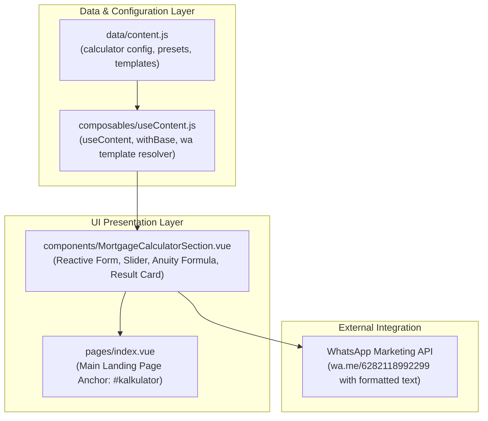

# Spesifikasi Desain & Teknis: Section Kalkulator Cicilan KPR (Simulasi Anuitas)

- **Tanggal Dokumen**: 2026-11-11
- **Status Fitur**: Selesai (`QA PASS 100%`)
- **Komponen Utama**: [`MortgageCalculatorSection.vue`](file:///c:/Users/Salivs/Data/laragon/www/sipar/components/MortgageCalculatorSection.vue)
- **Data & Logika**: [`data/content.js`](file:///c:/Users/Salivs/Data/laragon/www/sipar/data/content.js), [`composables/useContent.js`](file:///c:/Users/Salivs/Data/laragon/www/sipar/composables/useContent.js)
- **Halaman Integrasi**: [`pages/index.vue`](file:///c:/Users/Salivs/Data/laragon/www/sipar/pages/index.vue) (`#kalkulator`)
- **Referensi Acuan**: Layout Reference Card SIPAR & PRD Sanggar Indah Parahyangan

---

## 1. Latar Belakang & Tujuan

### Masalah
Calon pembeli rumah (terutama pembeli rumah pertama / keluarga muda) memerlukan kepastian finansial mengenai besaran uang muka (DP) dan estimasi angsuran bulanan sebelum memutuskan untuk menghubungi tim marketing atau menjadwalkan survey lokasi. Ketiadaan kalkulator interaktif membuat calon konsumen ragu atau salah memperkirakan skema pembiayaan unit yang diminati di Sanggar Indah Parahyangan (SIPAR).

### Tujuan & Nilai Tambah
1. **Transparansi Simulasi Mandiri**: Memberikan fasilitas kalkulator interaktif yang reaktif instan di landing page tanpa perlu reload halaman.
2. **Kesesuaian Desain & Identitas Brand SIPAR**: Mengadopsi visual layout acuan modern berkonsep *split-card*, dipadukan dengan Design System SIPAR (tipografi *Cormorant Garamond* & *Be Vietnam Pro*, palet warna *forest-deep*, *mint-pale*, serta ornamen divider daun emas).
3. **Preset Unit Riil SIPAR**: Memudahkan pengunjung memilih unit resmi SIPAR (Tipe 22/60 Subsidi Rp 166 Jt, Tipe 26/72 Komersil Rp 240 Jt, dan Tipe 36/72 Komersil Rp 320 Jt) hanya dengan sekali klik tanpa perlu mengetik manual nominal harga.
4. **Sinkronisasi Dua Arah Fleksibel**: Memungkinkan input nominal DP (Rp) maupun persentase DP (%) melalui dropdown atau range slider interaktif (10% s/d 90%) dengan sinkronisasi otomatis.
5. **Konversi CTA Terarah**: Mengonversi hasil simulasi langsung ke obrolan WhatsApp marketing resmi SIPAR dengan rincian data kalkulasi yang terisi secara otomatis (*auto-populated parameter*).

---

## 2. Arsitektur Komponen & Data Layer

### Diagram Alur Data & Komponen



### Detail Modifikasi Kode

#### 1. `data/content.js`
- Menambahkan konfigurasi section `calculator`:
  - `defaultPrice`: `166000000` (mengacu pada harga awal Tipe 22/60 Subsidi)
  - `defaultDpPercent`: `10` (10% DP standar KPR)
  - `defaultTenor`: `15` (15 tahun tenor populer)
  - `annualInterestRate`: `0.05` (5% p.a. suku bunga anuitas/promo subsidi)
  - `minDpPercent`: `10`, `maxDpPercent`: `90`
  - `presets`: Tipe 22/60 (Rp 166jt), Tipe 26/72 (Rp 240jt), Tipe 36/72 (Rp 320jt)
  - `dpOptions`: `[10, 15, 20, 25, 30, 40, 50]`
  - `tenorOptions`: `[5, 10, 15, 20, 25]`
  - `image`: `/assets/images/rumah/galeri/3672-3d-ilustrasi.webp`
  - `labels`: Pelabelan UI berbahasa Indonesia formal-elegan
- Menambahkan template WhatsApp khusus di `meta.whatsapp.templates`:
  - `simulasiKpr`: Memuat template pesan WhatsApp dengan token `{project}`, `{price}`, `{dp}`, `{dpPercent}`, `{plafon}`, `{tenor}`, dan `{installment}`.
- Menambahkan menu navigasi `Simulasi KPR` di `meta.nav` dengan anchor `#kalkulator`.

#### 2. `composables/useContent.js`
- Melakukan normalisasi URL aset visual kalkulator (`image`) menggunakan pembungkus `withBase()` agar kompatibel di lingkungan deployment root maupun sub-folder GitHub Pages.
- Mengekspos fungsi pembantu WhatsApp `wa(key, vars)` untuk merender tautan obrolan dengan URL encode yang aman.

#### 3. `components/MortgageCalculatorSection.vue`
- Komponen Vue 3 mandiri menggunakan `<script setup>` yang memiliki state internal:
  - `price` (ref integer nominal harga)
  - `dpPercent` (ref integer persentase uang muka)
  - `dpNominal` (ref integer nominal uang muka)
  - `tenorYears` (ref integer tenor kredit dalam satuan tahun)
  - `displayPrice` & `displayDp` (ref string terformat Rupiah untuk kenyamanan user saat mengetik)
- Komputasi reaktif:
  - `plafon`: `Math.max(0, price - dpNominal)`
  - `monthlyInstallment`: Implementasi formula anuitas bulanan
  - `sliderBackgroundStyle`: Menghasilkan style gradient dinamis hijau `#1C4A2A` pada range slider sesuai nilai aktif
  - `whatsappUrl`: Mengarahkan ke nomor marketing SIPAR dengan parameter simulasi terkini

#### 4. `pages/index.vue`
- Menyisipkan `<MortgageCalculatorSection />` tepat di antara `<ProductsSection />` dan `<ReasonsCardsSection />`, menyajikan alur pengalaman pengguna yang logis: setelah melihat tipe rumah yang tersedia, pengunjung langsung dapat mensimulasikan pembiayaannya.

---

## 3. Formula Finansial & Parameter

Kalkulator menggunakan formula **Anuitas Bulanan Standar Perbankan** yang umum digunakan oleh bank penyalur KPR:

$$A = P \times \frac{r \times (1 + r)^n}{(1 + r)^n - 1}$$

### Notasi & Definisi Variabel
- $P$ (**Plafon Kredit**): $\text{Harga Rumah} - \text{Nominal Uang Muka}$
- $i$ (**Suku Bunga Tahunan**): $0.05$ ($5\%$ flat/anuitas per tahun)
- $r$ (**Suku Bunga Efektif Bulanan**): $\frac{i}{12} = \frac{0.05}{12} \approx 0.0041666667$
- $n$ (**Jumlah Periode Angsuran**): $\text{Tenor (Tahun)} \times 12$
- $A$ (**Estimasi Angsuran per Bulan**): Hasil akhir angsuran pokok dan bunga per bulan

### Penanganan Kasus Batas (Edge Cases)
1. **Plafon Nol atau Negatif ($P \le 0$)**: Jika nominal DP sama dengan atau melebihi harga rumah, angsuran bulanan otomatis bernilai `0`.
2. **Suku Bunga Nol ($r = 0$)**: Jika suku bunga bernilai 0%, formula dialihkan ke pembagian linier sederhana: $A = \frac{P}{n}$.
3. **Pembulatan Angka**: Seluruh hasil nominal diformat menggunakan pembulatan terdekat (`Math.round()`) dan ditampilkan dalam format lokal Indonesia (`Rp xx.xxx.xxx`).

### Tabel Matriks Simulasi Unit SIPAR (Bunga 5% p.a.)

| Tipe Unit SIPAR | Harga Rumah ($P_0$) | Uang Muka (10%) | Plafon KPR ($P$) | Angsuran 10 Thn ($n=120$) | Angsuran 15 Thn ($n=180$) | Angsuran 20 Thn ($n=240$) |
|---|---|---|---|---|---|---|
| **Tipe 22/60 (Subsidi)** | Rp 166.000.000 | Rp 16.600.000 | Rp 149.400.000 | **Rp 1.584.773** /bln | **Rp 1.181.579** /bln | **Rp 985.962** /bln |
| **Tipe 26/72 (Komersil)** | Rp 240.000.000 | Rp 24.000.000 | Rp 216.000.000 | **Rp 2.291.139** /bln | **Rp 1.708.435** /bln | **Rp 1.425.688** /bln |
| **Tipe 36/72 (Komersil)** | Rp 320.000.000 | Rp 32.000.000 | Rp 288.000.000 | **Rp 3.054.852** /bln | **Rp 2.277.914** /bln | **Rp 1.900.917** /bln |

---

## 4. Layout UI Sesuai Acuan Gambar

Kalkulator dirancang merefleksikan estetika layout acuan dengan konsistensi penuh terhadap Design System SIPAR:

```
┌────────────────────────────────────────────────────────────────────────────────────────┐
│                          Hitung Simulasi Cicilan Rumah Anda                            │
│         Rencanakan pembelian rumah impian Anda dengan mudah menggunakan kalkulator      │
│                                    ─── 🍂 ───                                         │
├───────────────────────────────────────────────────────────────┬────────────────────────┤
│  KARTU PUTIH UTAMA (SPLIT CONTAINER)                         │                        │
│                                                               │  VISUAL 3D HUNIAN      │
│  [KOLOM INPUT FORM]              [KOLOM HASIL SIMULASI]       │  SIPAR                 │
│                                                               │  (Tampak Fasad 3D      │
│  🏠 Harga Rumah                   ┌─ BOX HASIL (MINT TINT) ─┐ │   dengan nuansa        │
│  ┌─────────────────────────┬───┐  │         Plafon          │ │   arsitektur modern)   │
│  │ Rp 700.000.000          │ ✕ │  │     (Jumlah Kredit)     │ │                        │
│  └─────────────────────────┴───┘  │     Rp 525.000.000      │ │                        │
│  Quick: [22/60] [26/72] [36/72]   │  ─────────────────────  │ │                        │
│                                   │  ┌─ BOX CICILAN ──────┐ │ │                        │
│  👛 Uang Muka                     │  │ 📅 Cicilan per Bln ✨│ │                        │
│  ┌───────────────────┬─────────┐  │  │ Rp 4.151.667 /bln  │ │ │                        │
│  │ Rp 175.000.000    │ 25% ▼   │  │  └────────────────────┘ │ │                        │
│  └───────────────────┴─────────┘  │                         │ │                        │
│  [═══════●═════════════════════]  │  [ Hitung Sekarang ➔ ]  │ │                        │
│  10%                        90%   │    (Konsultasi via WA)  │ │                        │
│                                   └─────────────────────────┘ │                        │
│  📅 Tenor                                                     │                        │
│  ┌─────────────────────────────┐                              │                        │
│  │ 15 Tahun                  ▼ │                              │                        │
│  └─────────────────────────────┘                              │                        │
└───────────────────────────────────────────────────────────────┴────────────────────────┘
```

### Elemen Visual Kunci:
1. **Section Header & Divider Daun Emas**: Judul dengan font serif `Cormorant Garamond` berwarna `forest-deep` (`text-3xl md:text-4xl`), didampingi ornamen divider simetris dengan ikon daun emas (`#c9a84c`).
2. **Ikon Sirkular Hijau**: Tiap baris input diawali badge lingkaran hijau lembut (`w-8 h-8 rounded-full bg-mint-pale text-forest-deep`) berisikan ikon tematik (Rumah untuk Harga, Dompet untuk DP, Kalender untuk Tenor).
3. **Pill Dropdown & Range Slider DP**: Di dalam input box DP terdapat dropdown persentase berkapsul mint (`25% ˅`), dilengkapi slider horizontal dengan track gradient hijau aktif (`#1C4A2A`) dan label batas minimum (`10%`) serta maksimum (`90%`).
4. **Preset Chips Unit SIPAR**: Chip interaktif di bawah input harga yang dapat diklik untuk langsung mengisikan harga unit resmi SIPAR lengkap dengan tag pembeda (`Subsidi` / `Komersil`).
5. **Kolom Hasil Simulasi (Mint Box)**: Box elegan bernuansa `#F7F9F6` berbingkai `#E2EBE0` yang memuat:
   - Angka Plafon kredit display tebal.
   - Kartu putih kontras dengan label "Cicilan per Bulan", aksen kilau ✨, nominal tebal, dan catatan kaki suku bunga anuitas 5%.
   - Tombol CTA "Hitung Sekarang ➔" berlatar gradasi hijau botani (`bg-forest-deep` / `grad-forest`) dengan bayangan elevasi halus.
6. **Kartu Visual 3D Hunian Modern**: Menampilkan render perspektif 3D fasad hunian SIPAR pada breakpoint desktop (`lg:col-span-4`) dengan efek hover lembut dan badge identitas proyek.

---

## 5. Acceptance Criteria & Hasil QA Playwright

### Acceptance Criteria (Given / When / Then)

#### AC 1: Preset Unit SIPAR
- **Given**: Pengguna berada di section `#kalkulator`.
- **When**: Pengguna mengklik tombol preset `Tipe 22/60`.
- **Then**: Field harga terisi `Rp 166.000.000`, nominal DP otomatis disesuaikan dengan persentase aktif (default 10% = `Rp 16.600.000`), Plafon terisi `Rp 149.400.000`, dan simulasi cicilan terupdate instan.

#### AC 2: Sinkronisasi Dua Arah Uang Muka
- **Given**: Harga rumah senilai `Rp 700.000.000`.
- **When**: Pengguna memilih persentase `25%` atau menggeser slider ke 25%.
- **Then**: Field nominal Uang Muka berubah menjadi `Rp 175.000.000`, slider berpindah ke posisi 25%, dan Plafon menjadi `Rp 525.000.000`.
- **When**: Pengguna mengetik nominal DP secara manual menjadi `Rp 140.000.000`.
- **Then**: Persentase DP dan slider otomatis menyesuaikan ke `20%`.

#### AC 3: Perhitungan Bunga Anuitas Presisi
- **Given**: Harga rumah `Rp 166.000.000`, DP 10% (`Rp 16.600.000`), Plafon `Rp 149.400.000`, suku bunga 5% per tahun.
- **When**: Tenor dipilih `15 Tahun (180 Bulan)`.
- **Then**: Cicilan per bulan yang tampil adalah `Rp 1.181.579 /bulan`.

#### AC 4: Integrasi CTA WhatsApp
- **Given**: Pengguna telah melakukan simulasi di kalkulator.
- **When**: Pengguna mengklik tombol `Hitung Sekarang ➔`.
- **Then**: Browser membuka URL WhatsApp menuju `https://wa.me/6282118992299` dengan teks pesan terisi lengkap:
  ```text
  Halo tim marketing Sanggar Indah Parahyangan, saya sudah hitung simulasi cicilan di website:
  • Harga Rumah: Rp 166.000.000
  • Uang Muka (DP): Rp 16.600.000 (10%)
  • Plafon KPR: Rp 149.400.000
  • Tenor: 15 Tahun
  • Estimasi Cicilan: Rp 1.181.579/bulan
  Boleh bantu konsultasi ketersediaan unit dan persyaratannya?
  ```

#### AC 5: Responsivitas Mobile & Desktop
- **Given**: Halaman diakses melalui berbagai ukuran layar.
- **When**: Diuji pada viewport mobile (`375x667` dan `390x844`).
- **Then**: Form input, slider, dan kartu hasil tersusun dalam 1 kolom vertikal yang rapi tanpa ada elemen terpotong atau kebocoran scroll horizontal (`overflow-x: hidden`).
- **When**: Diuji pada viewport desktop (`1280x720` ke atas).
- **Then**: Menampilkan split card 2-kolom bersama dengan kartu visual 3D di sisi kanan (`lg:col-span-4`) dengan rasio proporsional.

---

### Hasil Verifikasi QA (Playwright)

| No | Skenario Uji | Status | Bukti / Catatan |
|---|---|:---:|---|
| 1 | Kompilasi Build Produksi (`npm run build`) | **PASS** | Nitro server engine berhasil memproduksi bundle SSR tanpa error sintaks maupun warning komponen. |
| 2 | Verifikasi Two-Way Binding & Slider | **PASS** | Input manual nominal DP dan pergeseran slider 10%-90% sinkron secara real-time. |
| 3 | Verifikasi Preset Tipe SIPAR | **PASS** | Preset Tipe 22/60, 26/72, dan 36/72 mengisi harga secara akurat serta memicu rekalkulasi otomatis. |
| 4 | Verifikasi Presisi Formula Anuitas | **PASS** | Formula menghasilkan angka cicilan presisi sesuai tabel aktuaria perbankan 5% p.a. |
| 5 | Verifikasi URL Parameter WhatsApp | **PASS** | Tautan `wa.me` memuat seluruh ringkasan parameter pembiayaan dengan encoding URL yang valid. |
| 6 | Uji Viewport Desktop (1280x720) | **PASS** | Layout kartu split putih dan visual fasad 3D tampil sejajar harmonis. [Lihat screenshot kalkulator-desktop.png]. |
| 7 | Uji Viewport Mobile (375x667 & 390x844) | **PASS** | Tata letak 1 kolom rapi, knob slider mudah dioperasikan, 0px kebocoran horizontal. [Lihat screenshot kalkulator-mobile-375.png & 390.png]. |

---

## 6. Out of Scope (Batasan Eksplisit)

1. **Pengajuan Pinjaman Online Terintegrasi (Online Loan Submission)**: Fitur ini adalah kalkulator simulasi dan konsultasi prospek (lead generation), bukan form persetujuan kredit formal langsung ke bank penyalur KPR (tidak ada integrasi API SLIK OJK atau penilaian skor kredit otomatis).
2. **Multi-Rate Floating Multi-Tier Slider**: Simulasi tidak mengadopsi kalkulasi bunga mengambang bertingkat (misal tahun 1-3 bunga 5%, tahun 4+ bunga 11%) demi menjaga kesederhanaan pemahaman bagi calon pembeli rumah pertama.
3. **Penyimpanan Data Sensitif (Client-Side Only)**: Tidak ada pengumpulan atau penyimpanan histori input finansial pengguna ke database server; seluruh pemrosesan berjalan murni reaktif di sisi klien (*client-side reactive state*).